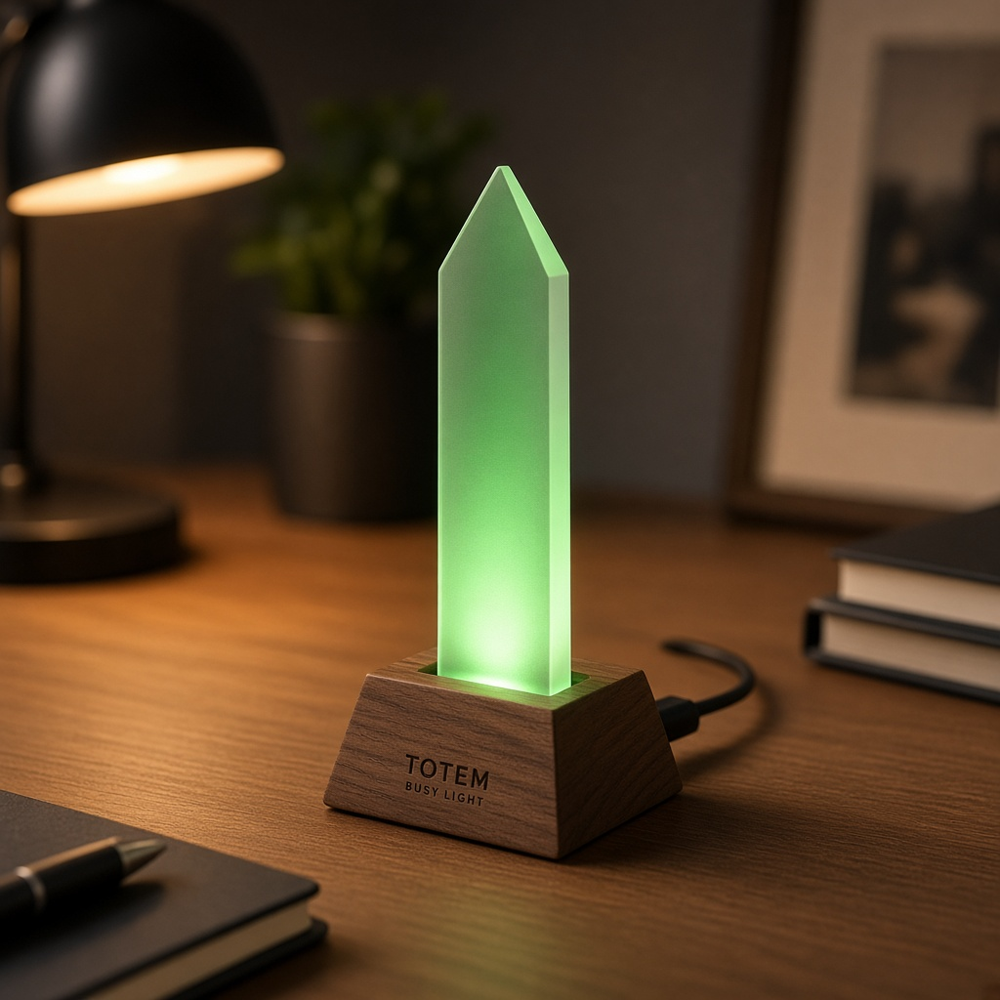
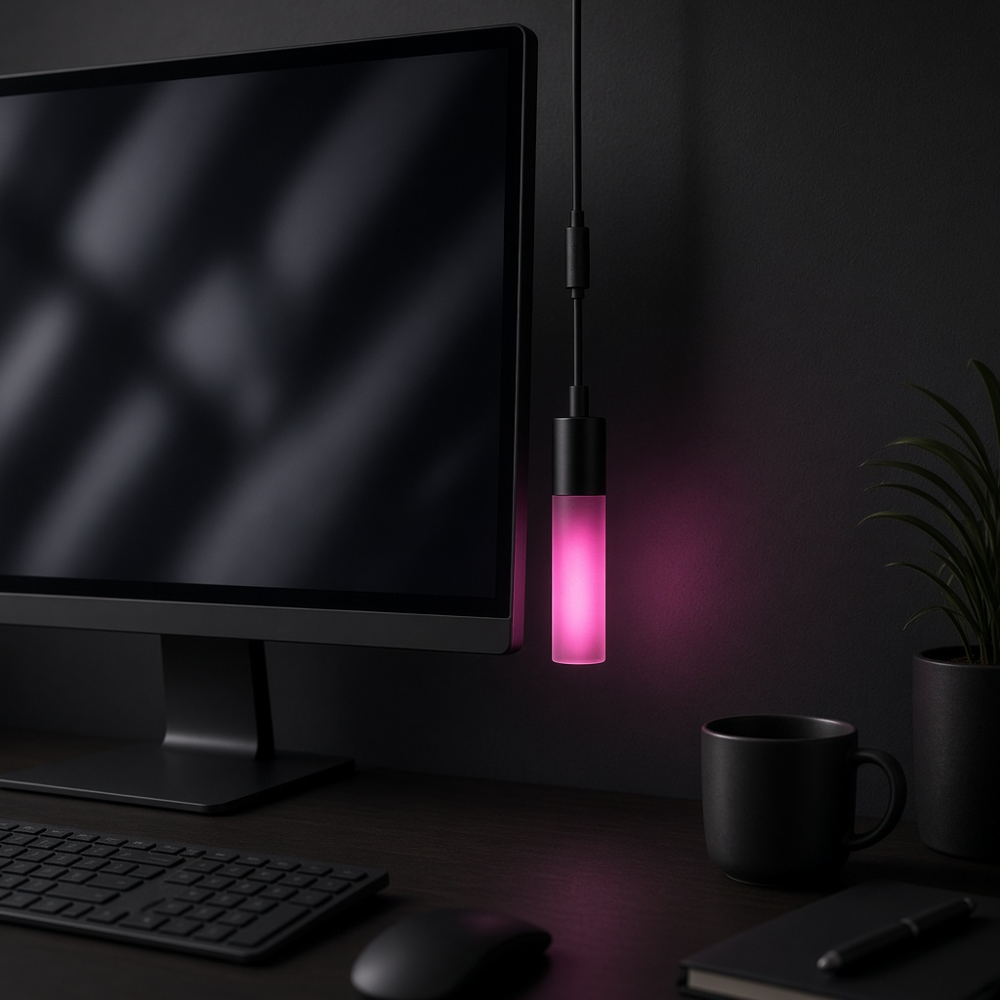
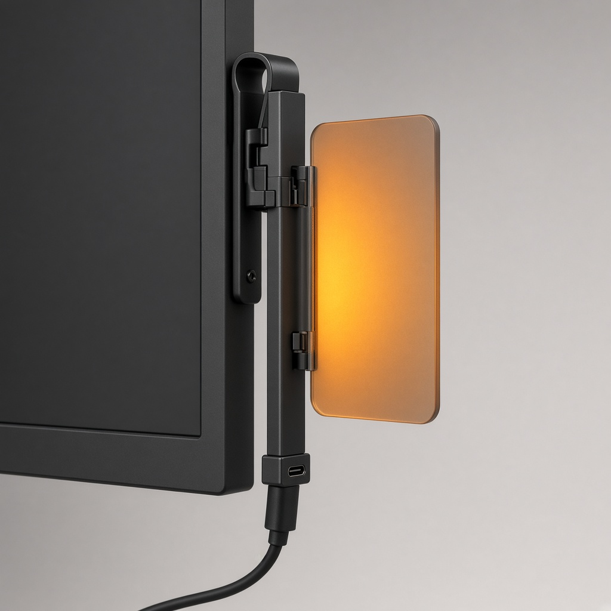
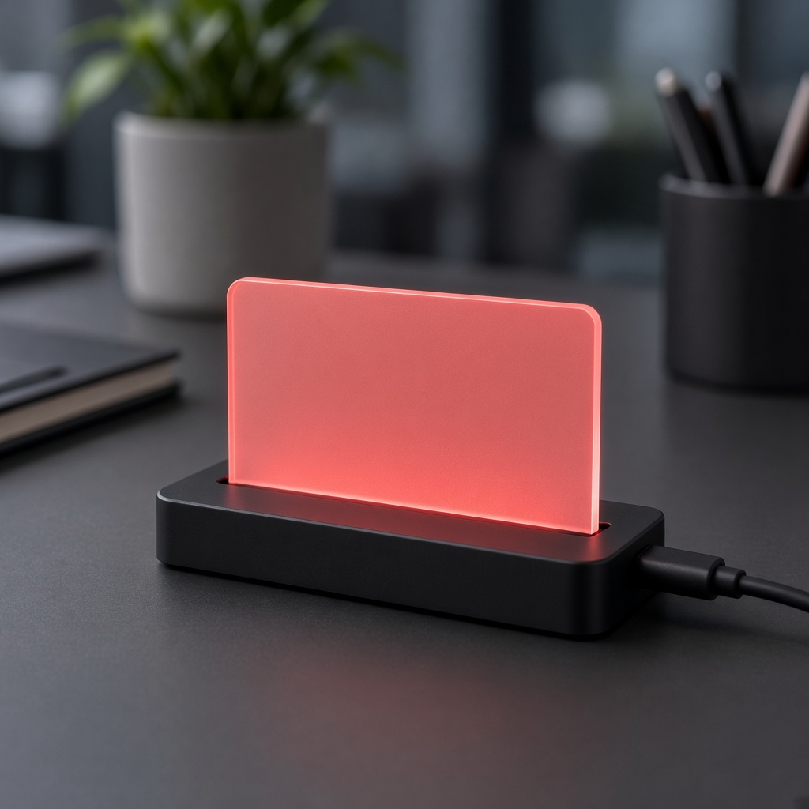

# Conceitos de produto

Quatro formas para a mesma placa [rev C](../../hardware/revC/README.md): 11 × 44 mm, 3× WS2816B-2020 em linha, STM32C071 e USB-C. O circuito não muda. Muda o invólucro e o caminho da luz até o acrílico.

Na rev C a ponta y = 0 é o topo da placa. D3, D2 e D1 ficam no centro da largura de 11 mm, a 3 mm, 10 mm e 17 mm dessa ponta, na face de cima. O USB-C fica na extremidade oposta (y = 44) e sobressai 0,7 mm. O WS2816B-2020 emite pela face de cima do encapsulamento, no sentido normal à placa — a face que, no desenho da rev C, olha para a raiz do difusor.

> **Nota:** as imagens desta pasta são renders conceituais gerados por IA. Não são fotografias de um produto real nem de um protótipo fabricado.

## Totem

Prisma de acrílico fosco, iluminado pela borda, sobre uma base de madeira. A luz entra por baixo e o volume acende, mais forte perto da base. O cabo sai pela lateral da madeira.

A placa fica em pé dentro da base, com a ponta dos LEDs apontando para cima. Os três WS2816B-2020 entram no acrílico. Há dois encaixes:

- **LEDs na borda.** A face de cima encosta na borda inferior do prisma. D3, D2 e D1 injetam luz direto nessa borda, sem trocar peça nem mover componente.
- **LEDs de emissão lateral.** Se o prisma continuar a ponta da placa e a luz tiver de sair no plano dela, a fileira troca para LEDs laterais no mesmo eixo. O contorno de 11 × 44 mm permanece; a peça do LED é que muda.

O USB-C fica escondido na base de madeira.

## Pendente

Cilindro de vidro ou acrílico fosco, com tampa de alumínio preto, pendurado pelo próprio cabo USB-C atrás do monitor. O corpo acende por inteiro e a luz passa para a parede.

A placa tem 11 mm de largura e cabe num tubo de cerca de 13 mm de diâmetro interno sem mudança de contorno, de componentes nem de roteamento. Os três LEDs em linha ficam dentro do cilindro e o iluminam por dentro. O USB-C fica na extremidade de cima: o cabo alimenta e segura a peça. A tampa de alumínio fecha a ponta de baixo.

## Bandeirola dobrável

Haste de alumínio com clipe para o monitor e uma bandeira de acrílico fosco em dobradiça, iluminada pela borda. A bandeira recolhe contra a haste. O USB-C fica na ponta de baixo da haste.

A placa de 11 × 44 mm entra na haste, com o conector na extremidade inferior. A ponta dos LEDs aponta para a dobradiça. Dois caminhos de luz:

- **LEDs voltados para a dobradiça.** A face de cima, que na rev C já olha para a raiz do difusor, encosta na borda da bandeira. D3–D1 acendem a bandeira direto.
- **Guia de luz.** Se o eixo da dobradiça não cobrir a fileira (D3 a 3 mm da ponta, D1 a 17 mm), um guia curto leva essa linha até a borda da bandeira.

O circuito permanece o mesmo.

## Mini letreiro

Placa de acrílico fosco lisa, sem texto, encaixada numa base de alumínio preto e iluminada pela borda. O cabo USB-C sai pela lateral da base.

Este é o arranjo ideal para edge-lit. A placa fica deitada na base, com a face de cima voltada para o acrílico e os três WS2816B-2020 em linha sob a borda inferior. A face emissora de cada LED aponta para essa borda, e o acrílico fosco espalha a luz pelo painel. Nenhuma peça precisa mudar de lugar. O USB-C, na ponta oposta aos LEDs, sai por um dos lados da base.
