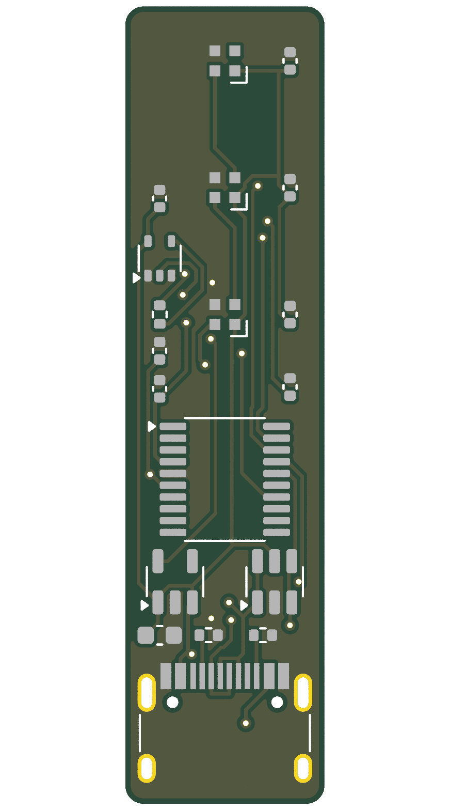

# Hardware: indicador próprio (rev A)

Placa de 3 LEDs RGB para um indicador de status no Linux:
- estados da IA: processando, atenção, erro;
- presença: em reunião ou livre.

A placa cabe no envelope de 48 × 15 × 34 mm do estudo de produto.

> **Estado:** projeto gerado e verificado no KiCad 9.0.2 (ERC 0, DRC 0 erros), **ainda não fabricado nem testado**. Leia "Pendências" antes de encomendar.



## Resumo

| Item | Valor |
|---|---|
| Placa | 11 × 44 mm, FR-4, 2 camadas, 0,8 mm, cantos com raio de 1 mm |
| Montagem | só na face de cima (JLCPCB, peças do catálogo); a face de baixo tem só os pads SWD |
| MCU | STM32C071F8P6, TSSOP-20, USB full-speed sem cristal |
| LEDs | 3 × SK6805-EC20 (2 × 2 mm), endereçáveis, 5 mA por canal |
| Alimentação | VBUS 5 V para os LEDs e o conversor de nível; 3,3 V do AP2112K para o MCU |
| Consumo | < 60 mA com tudo branco no máximo; 5 V/0,5 A do USB sobra |

## Orientação mecânica

```
 topo do aparelho (y = 0)
 ┌───────────┐
 │    D3     │  y = 3   LED topo  ┐
 │    D2     │  y = 10  LED meio  ├─ voltados para a raiz da bandeira
 │    D1     │  y = 17  LED baixo ┘
 │   [U1]    │  y = 26  MCU
 │ [U2] [U4] │  y = 32  regulador | ESD USB
 │ ▄▄USB-C▄▄ │  y = 44  borda; o receptáculo sobressai 0,7 mm
 └───────────┘
   11 mm
```

- A placa fica **em pé** dentro do corpo: altura de 44 mm no eixo Y do produto e largura de 11 mm na profundidade.
- A face com componentes olha para a bandeira.
- Os LEDs ficam centralizados na largura, a 5,5 mm da borda.
- A raiz da bandeira deve encostar ou ficar a até cerca de 0,5 mm da face dos LEDs.
- Os componentes vizinhos dos LEDs (até 1,1 mm de altura) estão a mais de 1,5 mm do centro. Por isso a raiz da bandeira pode ter **no máximo ~3 mm de espessura**.
- Sem furos de fixação: a placa é presa pelo corpo (canaletas nas bordas longas) e pelas pernas do USB-C.

## Arquivos

| Caminho | Conteúdo |
|---|---|
| `tools/netlist.py` | **Fonte da verdade**: componentes, footprints, códigos LCSC e ligações |
| `tools/gen_sch.py` | Gera o esquemático `indicador/indicador.kicad_sch` |
| `tools/gen_pcb.py` | Gera a placa: contorno, posicionamento, regras e planos de GND. Exporta o DSN e importa as trilhas do Freerouting |
| `tools/export_jlc.py` | Gera `indicador/jlc/`: `gerber.zip`, `bom.csv` e `cpl.csv` |
| `lib/` | Símbolo e footprint do SK6805-EC20 (pinagem do datasheet OPSCO rev A2) |
| `indicador/` | Projeto KiCad e PDF do esquemático |

### Regenerar tudo

```bash
cd hardware
python3 tools/gen_sch.py
python3 tools/gen_pcb.py                          # placa sem trilhas + indicador/indicador.dsn
java -jar freerouting-2.1.0.jar --gui.enabled=false \
     -de indicador/indicador.dsn -do /tmp/indicador.ses -mp 40
python3 tools/gen_pcb.py --ses /tmp/indicador.ses # importa as trilhas e preenche o GND
kicad-cli sch erc indicador/indicador.kicad_sch
kicad-cli pcb drc --schematic-parity indicador/indicador.kicad_pcb
python3 tools/export_jlc.py
```

O Freerouting 2.5.0 exige Java 25, e a versão nativa dele falhou. A **2.1.0 funciona com o Java 21** do Debian.

## Ligações principais

| Sinal | De | Para |
|---|---|---|
| USB D− / D+ | J1 A7/B7, A6/B6 | U4 (ESD) → U1 pino 16 (PA11) / 17 (PA12) |
| CC1 / CC2 | J1 A5 / B5 | 5,1 kΩ para o GND (dispositivo USB-C) |
| Dados dos LEDs | U1 pino 14 (PA7, SPI1_MOSI) | U3 74AHCT1G125 (3,3 → 5 V) → R3 33 Ω → D1 → D2 → D3 |
| SWD | U1 pinos 18 (SWDIO), 19 (SWCLK), 6 (NRST) | TP1–TP5 na face de baixo (3V3, SWDIO, SWCLK, NRST, GND) |

A cadeia segue a ordem do Luxafor: LED 1 = baixo, 2 = meio, 3 = topo.

## Pendências antes de encomendar

1. **Estoque do MCU:** a JLC tinha só **23** STM32C071F8P6 (C43650205) em 2026-11-08. Dá para protótipos; para série, considerar o STM32C071G8U6 (QFN-28) ou fazer pré-encomenda.
2. **Rotação no CPL:** conferir na prévia de montagem da JLC, principalmente U1, U2, U3, U4, J1 e os LEDs. O pino 1 do SK6805-EC20 (VDD) fica no canto marcado na serigrafia.
3. **Remapeamento do PA11:** no TSSOP-20, o pino 16 é PA9 ou PA11. O firmware precisa ativar o remapeamento no SYSCFG para usar o USB.
4. **Bootloader USB (DFU):** ainda não confirmei se a ROM do C071 tem DFU por USB. Se não tiver, a gravação é só pelos pads SWD (pogo pin + ST-Link).
5. **Modelos 3D:** o pacote `kicad-packages3d` não está instalado, então o render não mostra os componentes. Instale-o para checar alturas contra o corpo.
6. **Cotas do envelope:** as medidas do PDF são publicadas, não medidas. A largura de 11 mm e a posição dos LEDs precisam ser confirmadas quando o corpo for desenhado.

## Componentes (BOM)

Ver `indicador/jlc/bom.csv`. Todos são do catálogo JLC; os passivos são "basic" (sem taxa de setup).
