# Luxafor Flag: engenharia reversa

Engenharia reversa do [Luxafor Flag](https://luxafor.com/product/flag2/) (USB `04d8:f372`, firmware `0x3c`): protocolo HID, comportamento dos LEDs e, futuramente, o firmware.

O controle é feito em Python puro via `/dev/hidraw`, sem dependências.

## Hardware rev C: clone do Luxafor Flag

O desenho atual da placa própria está em [`hardware/revC/`](hardware/revC/). São 11 × 44 mm, com 3 LEDs RGB endereçáveis de **16 bits por canal** sob um único difusor, MCU STM32C071 com USB sem cristal e gravação por USB (DFU) ou SWD. A [rev B](hardware/revB/README.md) é a revisão anterior; a [rev A](hardware/README.md) permanece em `hardware/`.

> **Estado:** projeto verificado no KiCad 9.0.2 (ERC 0; DRC 0 erros, 0 pendências, paridade com o esquemático; 1 aviso esperado no footprint do USB-C), **ainda não fabricado nem testado**. Estoques conferidos na LCSC/JLC em 22/11/2026.

### Placa anotada

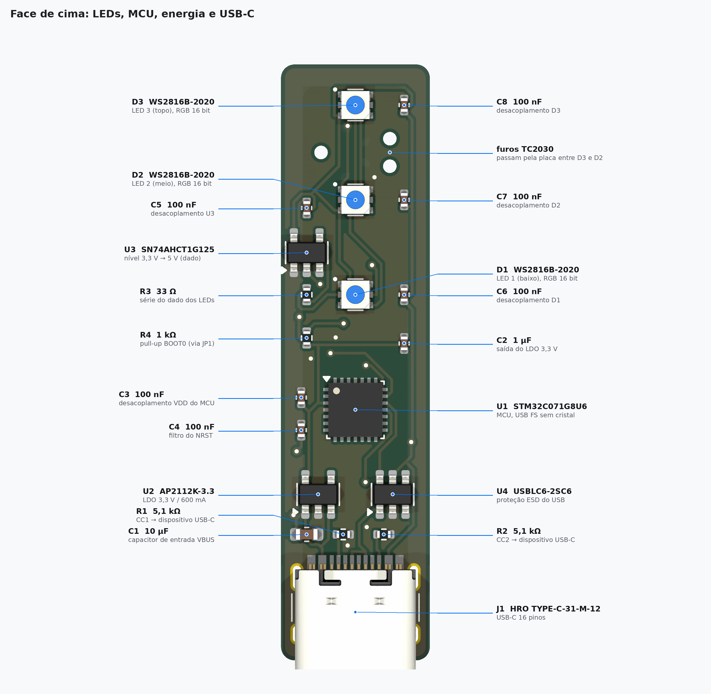

*Face de cima: LEDs WS2816B-2020, conversor de nível, MCU, LDO e USB-C.*

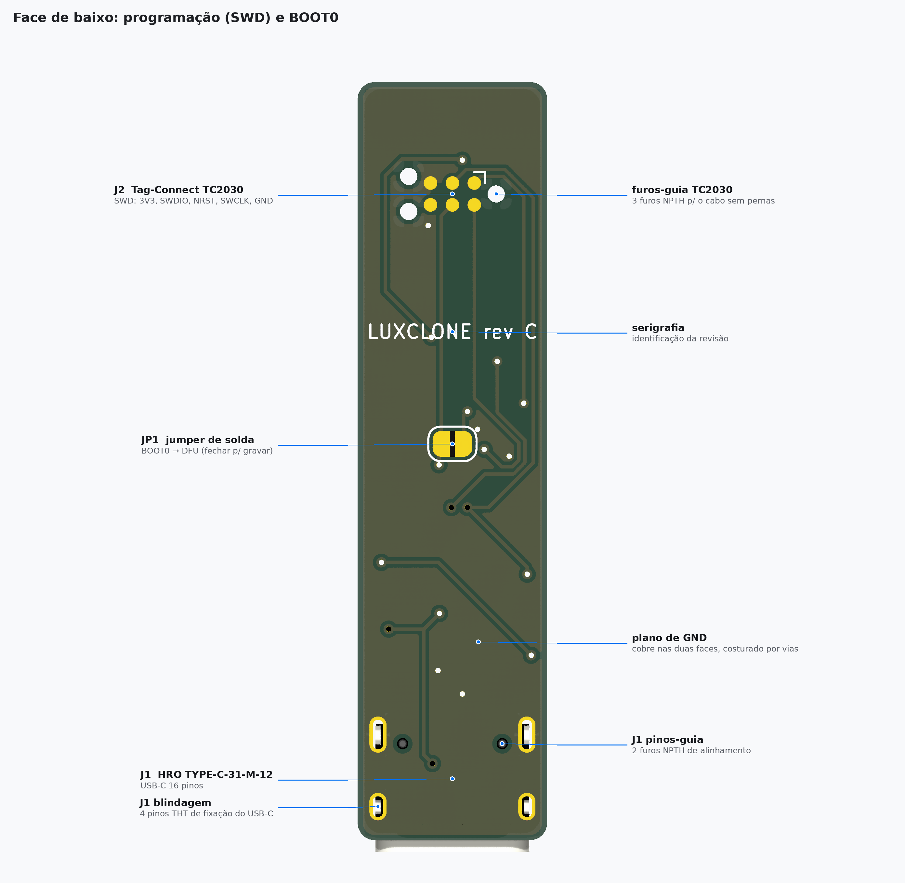

*Face de baixo: pads SWD (Tag-Connect), jumper BOOT0 e serigrafia «LUXCLONE rev C».*

### Galeria

<table>
  <tr>
    <td align="center" width="50%">
      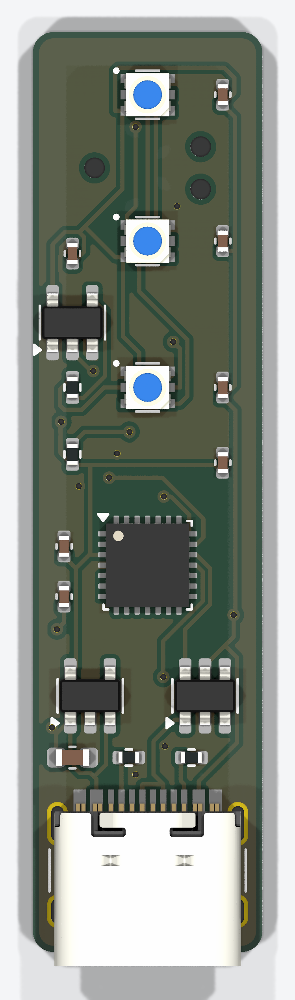<br>
      <strong>Face de cima</strong>
    </td>
    <td align="center" width="50%">
      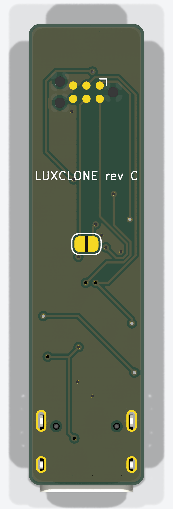<br>
      <strong>Face de baixo</strong>
    </td>
  </tr>
  <tr>
    <td align="center" colspan="2">
      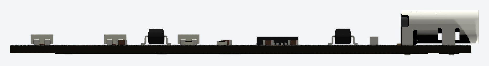<br>
      <strong>Vista lateral</strong>
    </td>
  </tr>
  <tr>
    <td align="center">
      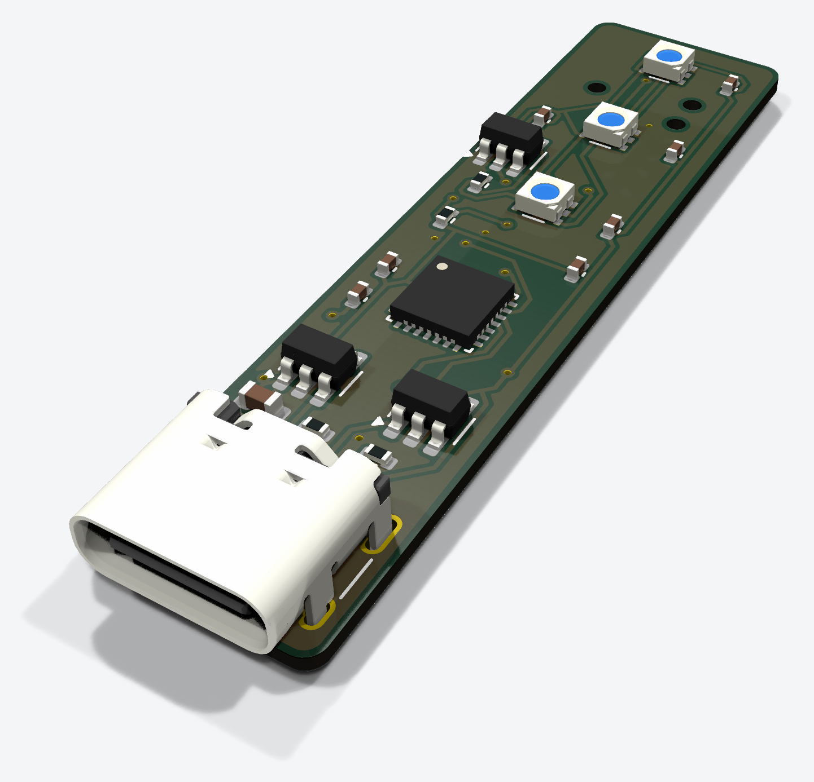<br>
      <strong>Isométrica da frente</strong>
    </td>
    <td align="center">
      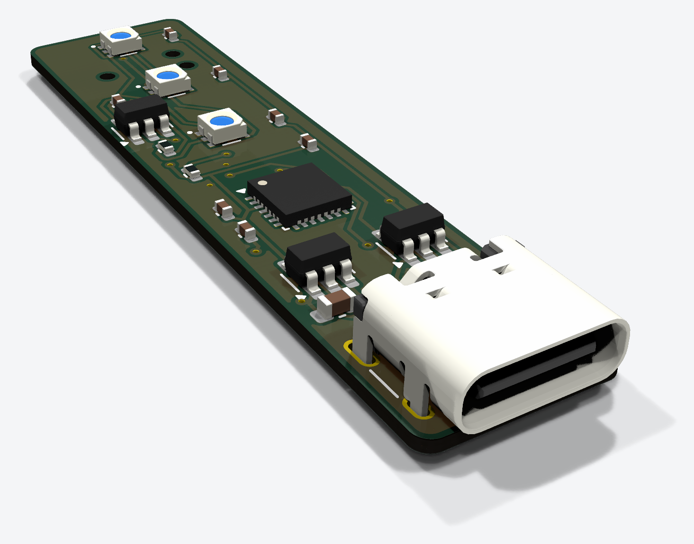<br>
      <strong>Isométrica da frente, outro ângulo</strong>
    </td>
  </tr>
  <tr>
    <td align="center">
      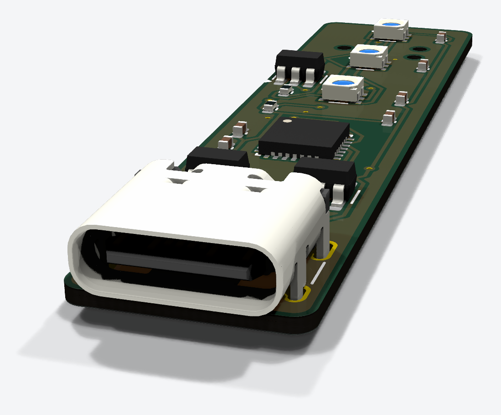<br>
      <strong>Ângulo baixo, a partir do conector</strong>
    </td>
    <td align="center">
      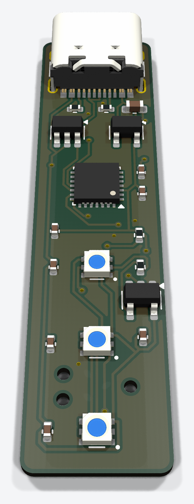<br>
      <strong>Vista pela ponta dos LEDs</strong>
    </td>
  </tr>
  <tr>
    <td align="center">
      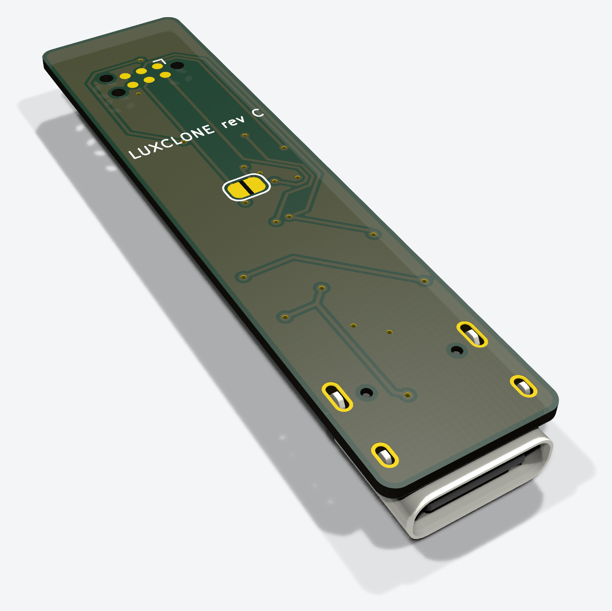<br>
      <strong>Isométrica do verso</strong>
    </td>
    <td align="center">
      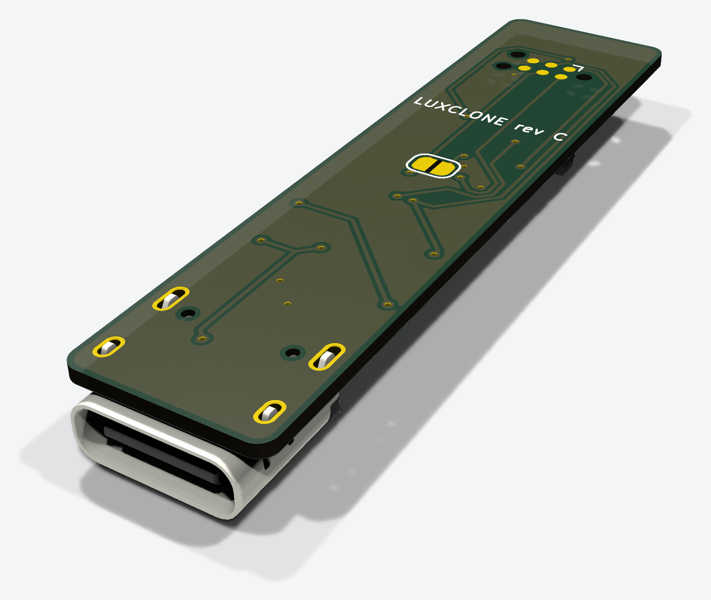<br>
      <strong>Isométrica do verso, outro ângulo</strong>
    </td>
  </tr>
</table>

<table>
  <tr>
    <td align="center" width="33%">
      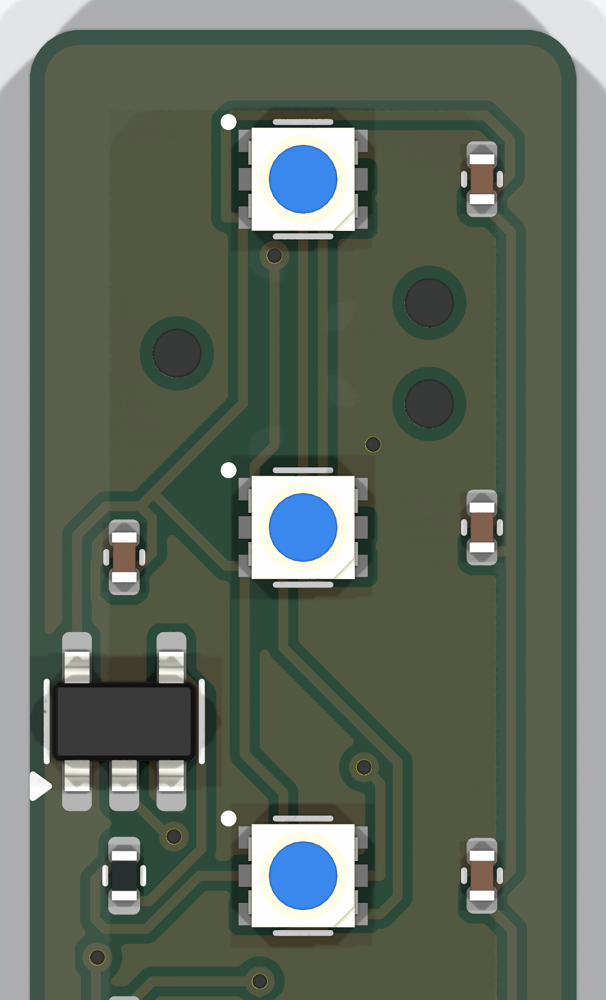<br>
      <strong>LEDs e conversor de nível</strong>
    </td>
    <td align="center" width="33%">
      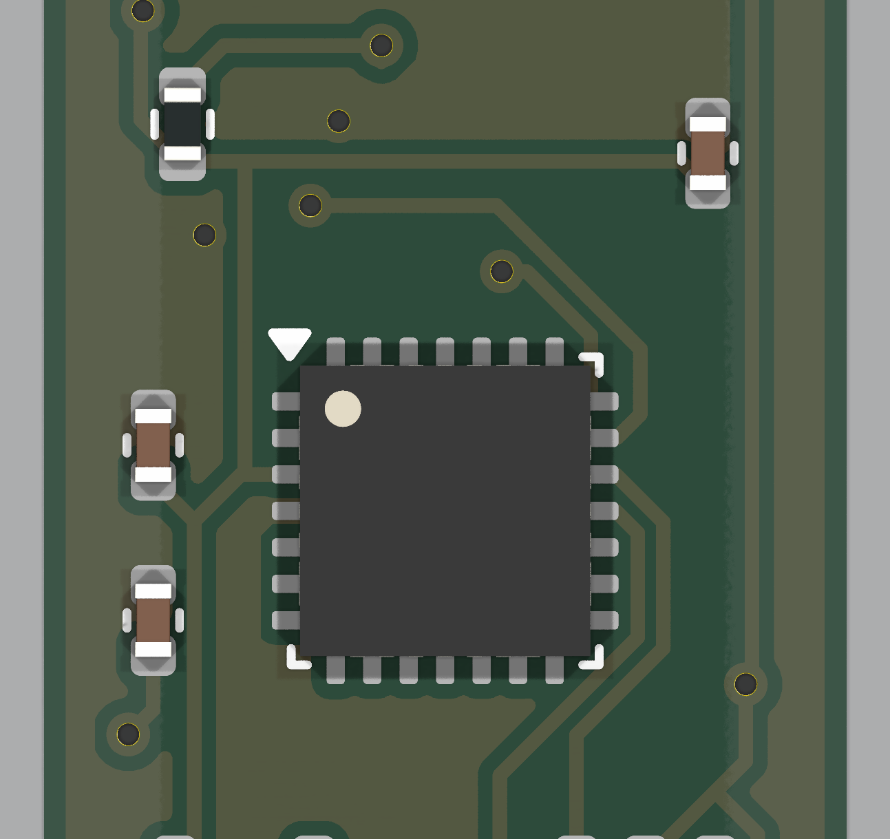<br>
      <strong>MCU</strong>
    </td>
    <td align="center" width="33%">
      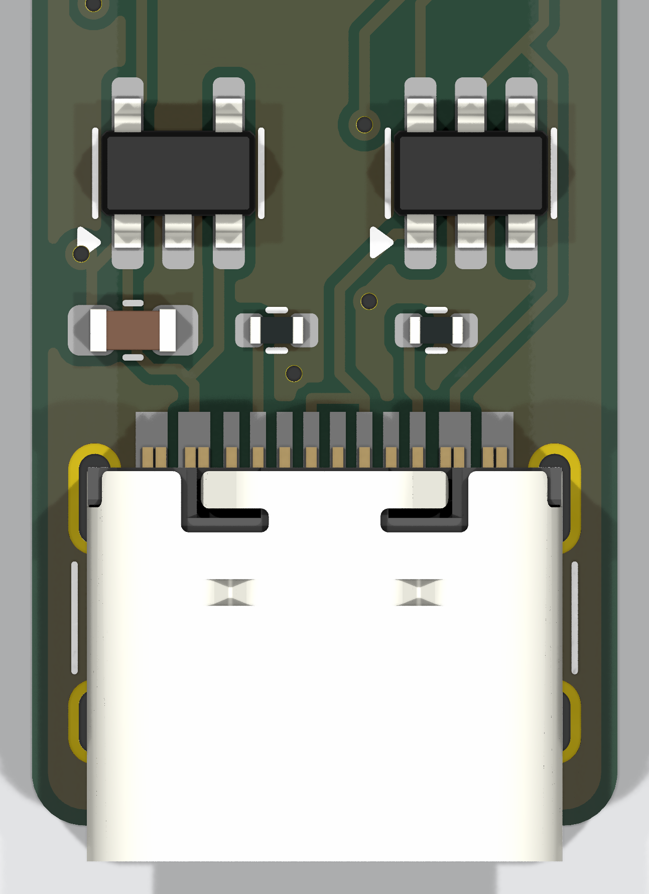<br>
      <strong>USB-C, LDO e ESD</strong>
    </td>
  </tr>
</table>

<table>
  <tr>
    <td align="center" width="33%">
      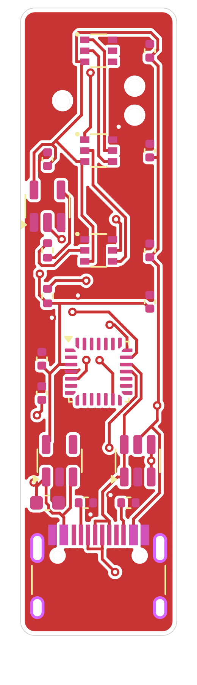<br>
      <strong>Cobre de cima</strong>
    </td>
    <td align="center" width="33%">
      <br>
      <strong>Cobre de baixo (espelhado)</strong>
    </td>
    <td align="center" width="33%">
      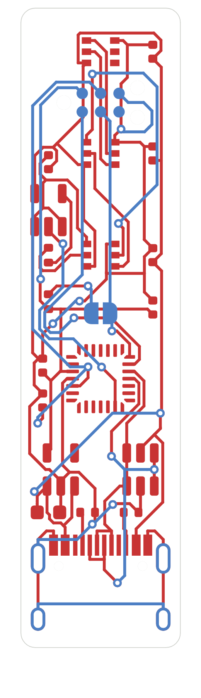<br>
      <strong>Só as trilhas (cima vermelho, baixo azul)</strong>
    </td>
  </tr>
</table>

### Lista de componentes

| Ref. | Função | Peça | Fabricante | LCSC | Motivo da escolha |
|---|---|---|---|---|---|
| D1–D3 | LEDs 1 (baixo), 2 (meio), 3 (topo) | WS2816B-2020 | Worldsemi | [C4154877](https://www.lcsc.com/product-detail/C4154877.html) | 16 bits por canal com gamma interna e PWM de 10 kHz: fades suaves até o mínimo de brilho e sem cintilação em câmera. Sinal duplo (BI/BO): se um LED falhar, os seguintes continuam recebendo dados. 2,2 × 2,0 mm. |
| U1 | MCU com USB | STM32C071G8U6 (QFN-28 4×4) | STMicroelectronics | [C44521811](https://www.lcsc.com/product-detail/C44521811.html) | USB Full Speed sem cristal (HSI48 + CRS), bootloader DFU por USB na ROM, Cortex-M0+ 48 MHz, 64 KB de flash. |
| U3 | Conversor de nível 3,3 V → 5 V do dado | SN74AHCT1G125DBVR (SOT-23-5) | Texas Instruments | [C7484](https://www.lcsc.com/product-detail/C7484.html) | O WS2816 pede VIH ≥ 0,7 × VDD = 3,5 V; o AHCT aceita 2 V na entrada com VCC = 5 V. Original TI, estoque alto. |
| U2 | LDO 3,3 V | AP2112K-3.3TRG1 | Diodes Inc. | [C51118](https://www.lcsc.com/product-detail/C51118.html) | 600 mA, 55 µA de consumo próprio, VIN máx. 6 V (margem sobre o VBUS). |
| U4 | Proteção ESD do USB | USBLC6-2SC6 | STMicroelectronics | [C7519](https://www.lcsc.com/product-detail/C7519.html) | Referência de mercado para USB 2.0, IEC 61000-4-2. |
| J1 | Conector USB-C 16 pinos | TYPE-C-31-M-12 | HRO (Korean Hroparts) | [C165948](https://www.lcsc.com/product-detail/C165948.html) | O USB-C mais usado na montagem JLC, com pinos THT de fixação. |
| J2 | Programação SWD | Tag-Connect TC2030-IDC-NL (só pads e furos) | Tag-Connect | — | Gravação/depuração sem conector montado. |
| JP1 + R4 | BOOT0 para DFU | jumper de solda + 1 kΩ | UNI-ROYAL | [C11702](https://www.lcsc.com/product-detail/C11702.html) | Recuperação por USB mesmo com firmware travado. |
| R1, R2 | CC1/CC2 do USB-C | 5,1 kΩ 0402 | UNI-ROYAL | [C25905](https://www.lcsc.com/product-detail/C25905.html) | Identifica a placa como dispositivo USB-C. |
| R3 | Série do dado dos LEDs | 33 Ω 0402 | UNI-ROYAL | [C25105](https://www.lcsc.com/product-detail/C25105.html) | Amortece reflexões na linha de dados. |
| C1 | Entrada VBUS | 10 µF 0603 X5R | Samsung | [C19702](https://www.lcsc.com/product-detail/C19702.html) | Reserva de carga para os LEDs. |
| C2 | Saída do LDO | 1 µF 0402 X5R | Samsung | [C52923](https://www.lcsc.com/product-detail/C52923.html) | Estabilidade do AP2112K. |
| C3–C8 | Desacoplamento (MCU, NRST, U3, LEDs) | 100 nF 0402 X7R | Samsung | [C1525](https://www.lcsc.com/product-detail/C1525.html) | Um por CI/LED, junto ao pino. |

Estoques, links e datasheets de cada peça (e das alternativas avaliadas) estão em [`hardware/revC/docs/parts-check.json`](hardware/revC/docs/parts-check.json).

### LEDs avaliados

| LED | Resolução de cor | PWM | Tamanho | Por que não |
|---|---|---|---|---|
| **WS2816B-2020 (escolhido)** | 16 bits + gamma | 10 kHz | 2,2 × 2,0 mm | — |
| SK6805-EC20 (rev B) | 8 bits | ~1 kHz | 2,0 × 2,0 mm | degraus visíveis em fades lentos e no brilho baixo |
| WS2812C-2020-V6 | 8 bits | 2 kHz | 2,0 × 2,0 mm | 8 bits |
| XL-1615RGBC-2812B | 8 bits | — | 1,6 × 1,5 mm | 8 bits |
| SK6812MINI-E | 8 bits | ~1 kHz | 3,2 × 2,8 mm | montagem reversa com furo na placa, 8 bits |
| WS2816C-2121 | 16 bits | 10 kHz | 2,1 × 2,1 mm | alternativa direta, mas metade da corrente (menos brilho) |
| WS2816C-1313/4P | 16 bits | 10 kHz | 1,3 × 1,3 mm | muito pequeno para inspeção/retrabalho; brilho menor |

### O que mudou da rev B para a rev C

| Item | Rev B | Rev C | Por quê |
|---|---|---|---|
| LEDs | SK6805-EC20, 8 bits, 4 pinos | **WS2816B-2020**, 16 bits, PWM 10 kHz, 6 pinos | Fades e mistura de cores muito mais suaves; redundância de dados BI/BO. Novo footprint e símbolo. |
| Ligação dos LEDs | DIN → DOUT | DI/DO + BI/BO (BI do LED 1 no GND) | Recomendação do datasheet Worldsemi. |
| Conversor de nível | 74AHCT1G125 JSMSEMI, SOT-353 (~800 em estoque) | **SN74AHCT1G125DBVR** TI, SOT-23-5 (~17 mil na LCSC) | Fabricante de referência e estoque. Footprint trocado. |
| Corrente máx. | ~55–60 mA | ~70 mA (3 × 20 mA + MCU) | WS2816B tem 20 mA por LED; continua abaixo dos 100 mA declarados. |
| Placa | 245 trilhas, 16 vias | mesmo contorno, re-roteada | 11 × 44 × 0,8 mm, 2 camadas, 314 trilhas e 20 vias (Freerouting + limpeza de pontas soltas). |

**Impacto no firmware:** o WS2816 recebe **48 bits por LED** (G16 R16 B16, MSB primeiro) em vez de 24, com os mesmos tempos de ~800 kHz (T0H 200–320 ns, T1H 520–800 ns, reset > 280 µs). O motor de fades passa a calcular em 16 bits. Os pinos 18 e 19 do QFN-28 são PA11[PA9] e PA12[PA10]: o firmware precisa ativar o remapeamento no SYSCFG para o USB.

### Pendências antes de encomendar

1. Conferir na prévia de montagem da JLC a rotação de U1–U4, J1 e D1–D3 (o CPL usa as rotações do KiCad).
2. Estoque do STM32C071G8U6 é baixo na JLC (109) e na LCSC (36) em 22/11/2026. Resultados de busca indicam ~2.781 na Mouser e 42 na DigiKey, mas não consegui abrir essas páginas do box (bloqueio 403): não verificado. A variante `G8U6N` (mais estoque na DigiKey) troca o pino 17 por `VDDIO2`; **não** usar sem revisar a placa.
3. Footprint do WS2816B-2020 desenhado a partir do datasheet (pads 0,65 × 0,45 mm, passo 0,77 mm, vão de 1,30 mm); conferir com a prévia da JLC antes de pagar.
4. Firmware ainda não existe para o WS2816 (48 bits por LED) nem confirma o remapeamento de PA11/PA12.
5. BOOT0 (JP1) só vale depois de gravar `nBOOT_SEL = 0`; com a flash vazia o chip já entra em DFU sozinho.
6. Modelos 3D de U1, J1 e dos LEDs nos renders são substitutos visuais.

## Conteúdo

| Arquivo | O que é |
|---|---|
| [PROTOCOLO.md](PROTOCOLO.md) | Especificação do protocolo, com cada item marcado como validado visualmente, medido ou em aberto |
| [luxafor.py](luxafor.py) | CLI e biblioteca de controle, com limites de segurança |
| [tools/anim.py](tools/anim.py) | Envia um comando cru e registra os eventos com timestamp |
| [hardware/revC/](hardware/revC/README.md) | Placa atual (rev C): STM32C071G8U6 + 3× WS2816B-2020 de 16 bits, KiCad 9, arquivos JLC |
| [hardware/revB/](hardware/revB/README.md) | Revisão anterior (rev B): STM32C071G8U6 (QFN-28) + 3× SK6805-EC20 |
| [hardware/](hardware/README.md) | Rev A: STM32C071F8P6 (TSSOP-20) + 3 LEDs SK6805, KiCad 9, arquivos JLC |

## Revisão anterior (rev B)

A [rev C](#hardware-rev-c-clone-do-luxafor-flag) é o desenho atual. A [rev B](hardware/revB/README.md) é a revisão anterior: a mesma placa de 11 × 44 mm, 2 camadas, ainda não fabricada nem testada, com 3× SK6805-EC20 de 8 bits. A [rev A](hardware/README.md) permanece no lugar.

- MCU STM32C071G8U6 (QFN-28), com DFU por USB — o mesmo da rev C.
- 3× SK6805-EC20 em 5 V, com buffer 74AHCT1G125 da JSMSEMI (a rev C troca pelo SN74AHCT1G125DBVR da TI e pelos WS2816B).
- USB-C com ESD (USBLC6-2SC6) e regulador AP2112K-3.3.
- ERC e DRC conferidos com `kicad-cli`: ERC sem mensagens; DRC sem pads desconectados e sem erros de footprint. Há um aviso de footprint local no conector USB-C (`lib_footprint_mismatch`, override local).

Em aberto na rev B: conferir as rotações do CPL na prévia da JLC, confirmar o remapeamento de PA11/PA12 no firmware, e a largura da placa, herdada da rev A. Essas conferências continuam valendo na rev C, junto com o footprint novo do LED.

## Uso rápido

```bash
./luxafor.py version                 # firmware 0x3c
./luxafor.py color top blue          # LEDs: all | bottom | middle | top
./luxafor.py fade all green 20 --wait
./luxafor.py strobe all red 10 3
./luxafor.py wave 1 cyan 5 60
./luxafor.py pattern rainbow --wait  # traffic, police, rainbow, ...
./luxafor.py off
```

Permissão: o usuário precisa de leitura e escrita em `/dev/hidrawN`. Em desktops com systemd isso costuma vir por ACL de sessão; se não vier, use uma regra udev.

## Resumo do que já se sabe

- HID vendor (`0xFF00`), relatórios de 8 bytes sem Report ID. Comandos: `01` cor, `02` fade, `03` strobe, `04` wave, `06` padrão, `80` versão.
- 3 LEDs RGB (baixo, meio, topo) com PWM linear de 8 bits.
- O dispositivo manda o evento `00 01` quando uma animação termina.

## Especificações públicas vs. esta unidade

| Item | Fabricante / varejo | Observado nesta unidade |
|---|---|---|
| Dimensões | 48 × 15 × 34 mm | não medido |
| Peso | 8 g (sem cabo) | não medido |
| LEDs | 6 RGB | 3 respondem (endereços 4–6 aceitos, nada acende) |
| Conector / cabo | USB-C, cabo de 1,5 m | — |
| Fixação | ímã com adesivo | — |
| Material da bandeira | policarbonato ou alumínio (as fontes divergem) | não verificado |

Fontes: [página do produto](https://luxafor.com/product/flag2/), [anúncio de varejo](https://www.desertcart.lk/products/541533457-flag-led-usb-busy-light-indicator-20-inch-usb-c), [análise no Gadget Explained](https://www.gadgetexplained.com/2017/02/luxafor-flag-office-busywork-usb-light.html). Materiais internos e encaixes não são documentados publicamente; só abrindo o case.

## ⚠️ Cuidados

- `01 13 …` (LED `0x13`) **trava o firmware**. Reconecte o aparelho fisicamente e **não** use reset USB por software, que travou o barramento USB do host.
- `51`, `52` e `62` são desconhecidos e podem gravar na memória não volátil. O serial desta unidade virou `000000000000` durante os testes.

## Roadmap

- [x] Descritores USB/HID
- [x] Comandos de LED, tempos e padrões (validados)
- [ ] Opcodes `00`, `51`, `52` e `62`
- [ ] Identificar o MCU (abrir o case, fotos da placa)
- [ ] Ler o firmware via ICSP e verificar se há bootloader
- [ ] Firmware próprio
