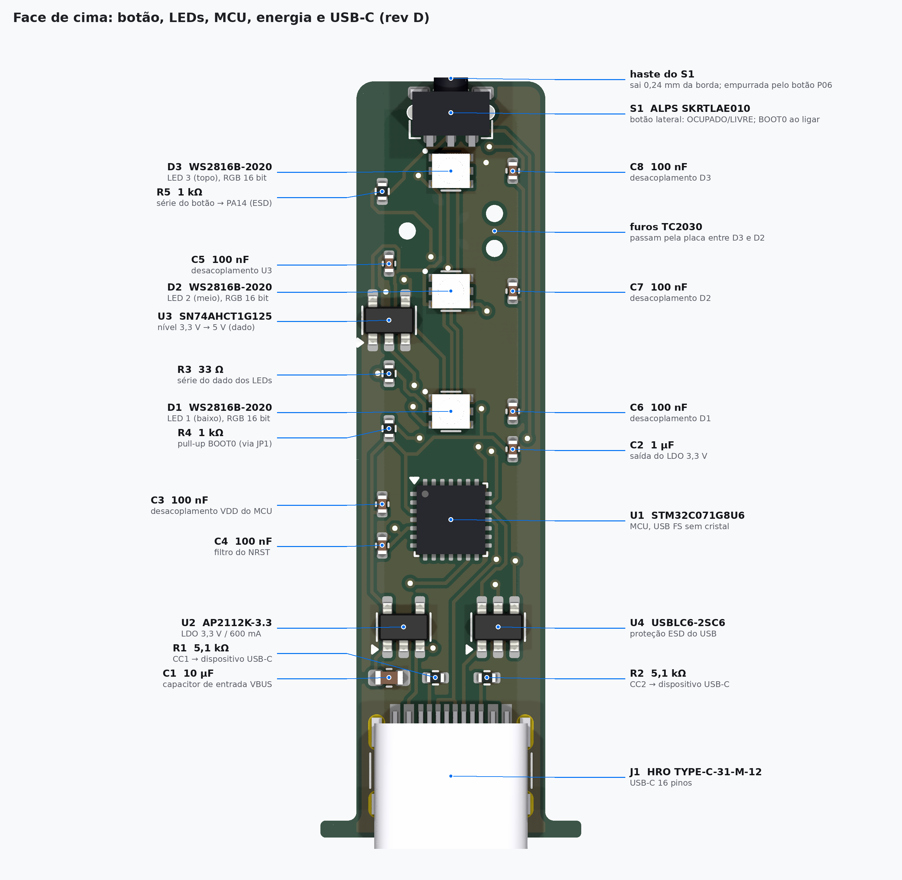
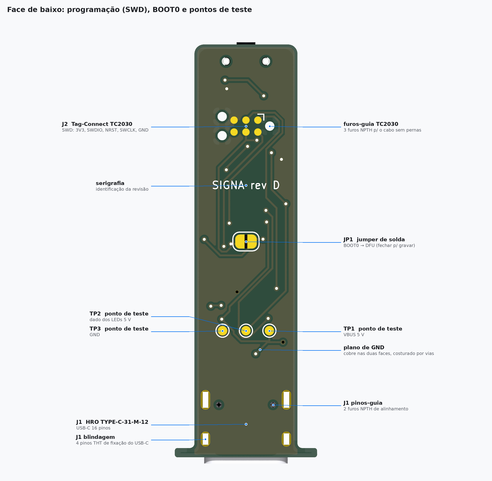
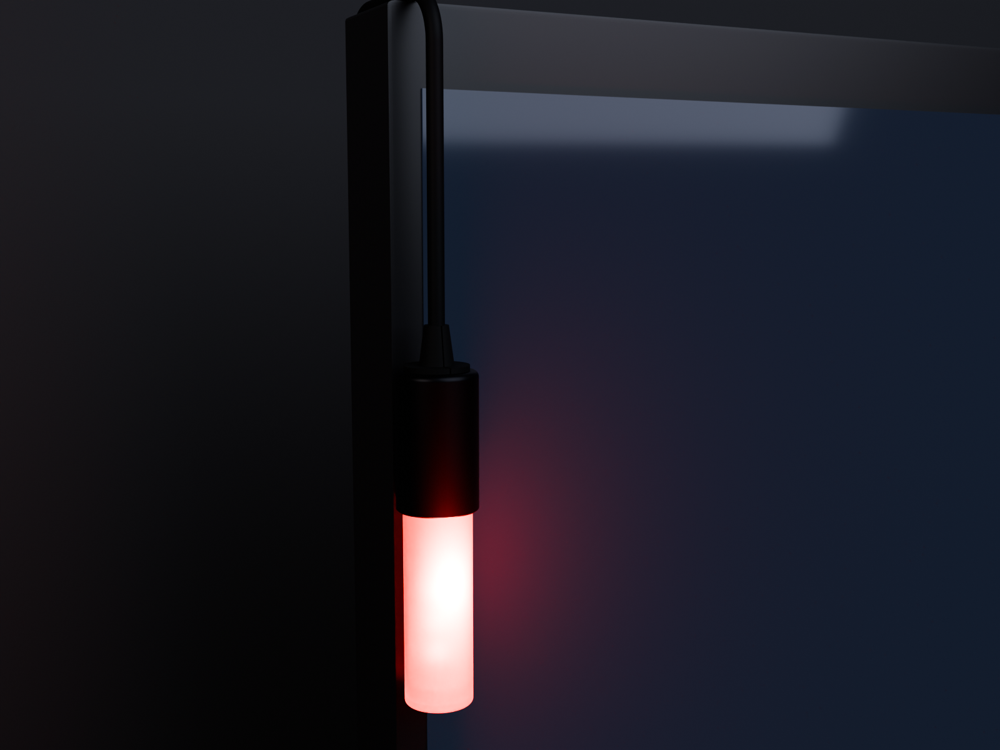
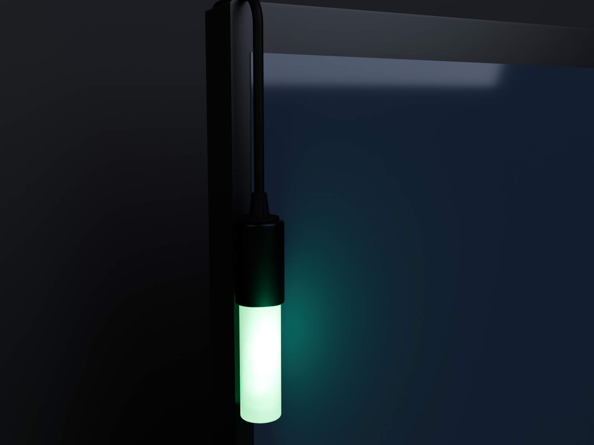
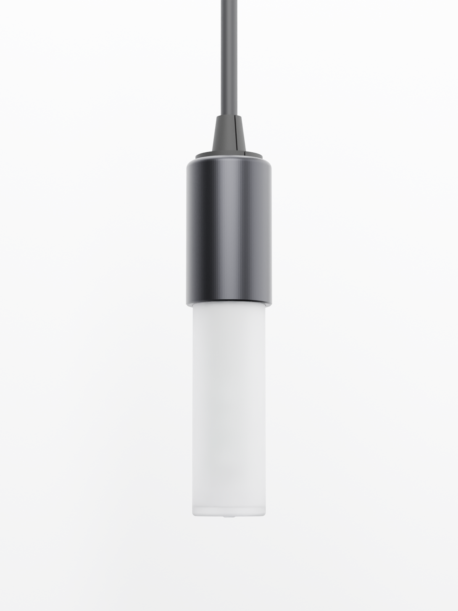
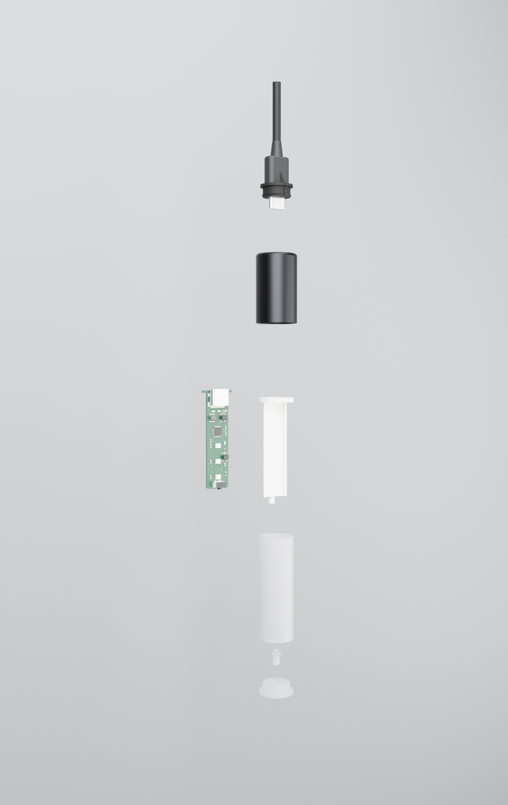
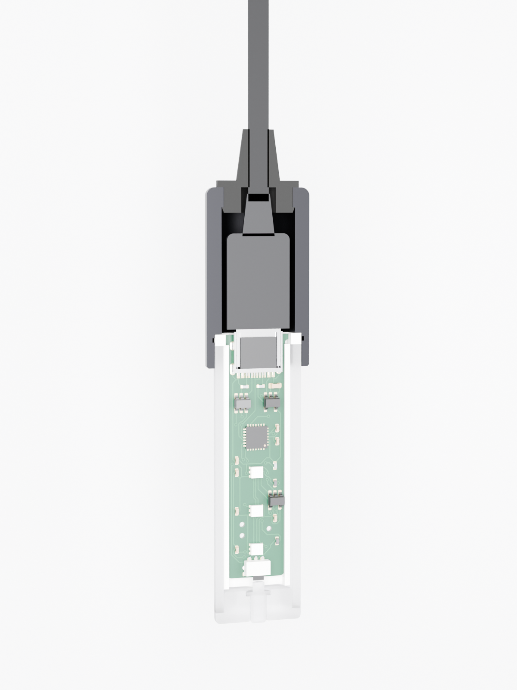
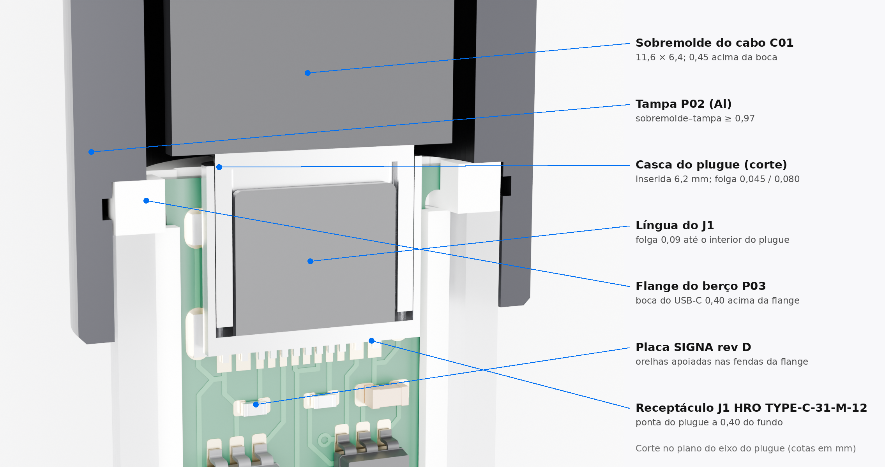

# SIGNA

Luz de presença USB-C para a sala — e, se você quiser, para acompanhar suas IAs.

O **modo sala** lê o Google Agenda e o Outlook e mostra se você está livre, prestes a entrar em uma reunião ou ocupado. O aviso de “prestes a entrar” é configurável no app (padrão: 5 minutos). O **modo IA** é opt-in: monitora Claude, ChatGPT e Grok e indica ocioso, processando, precisa de atenção, erro, ou limite atingido (cota de 5 h ou semanal).

Em modo misto, os LEDs 3 e 2 (topo e meio) mostram a sala e o LED 1 (baixo) mostra a IA. **OCUPADO tem prioridade máxima** e trava os três LEDs em vermelho; no v1 o LED da IA some, e isso não é configurável.

O nome **SIGNA** é provisório, até a busca de marca no INPI.

> **Estado em 22/11/2026:** projeto de placa (rev D) verificado no KiCad 9.0.2 (ERC 0, DRC 0 erros). Montagem 3D integrada (placa + corpo + cabo) sem interferências não intencionais. Firmware compila (≈ 17,5 KB) e os testes de host passam. **Nada foi fabricado nem testado em silício.**

## Estados

Prioridade 1 é a mais alta.

| Prioridade | Modo | Estado | Cor | Comportamento |
|---|---|---|---|---|
| 1 | Sala | OCUPADO | `#FF3B2F` | contínuo 1,0; trava os 3 LEDs (`0xFF`) |
| 2 | Sala | PRESTES A ENTRAR | `#FF8A1A` | pulso lento de 3 s; padrão 5 min antes do evento |
| 3 | IA | ERRO | `#FF3FC8` | 2,5 Hz com pulso de 130 ms (abaixo do limite WCAG de 3 Hz) |
| 4 | IA | PRECISA DE ATENÇÃO | `#FFE02E` | onda quadrada 1 Hz |
| 5 | IA | PROCESSANDO | `#3D8BFF` | respiração 2,4 s |
| 6 | IA | LIMITE ATINGIDO | `#9B5CFF` | cota de 5 h: pulso duplo; cota semanal: contínuo 0,28 |
| 7 | Sala | LIVRE | `#2FD28A` | contínuo 0,28 |
| 8 | IA | IA DESOCUPADA | `#7C8EA6` | contínuo 0,08 |

A tabela completa, com curvas e alocação dos LEDs, está em [`software/data/produto.json`](software/data/produto.json) e no [caderno conceitual](docs/caderno-signa/signa-conceito.pdf).

## Mapa do repositório

| Caminho | O que é |
|---|---|
| [`hardware/revD/`](hardware/revD/) | Placa atual: KiCad 9, gerbers, BOM, renders, [`CHANGELOG.md`](hardware/revD/CHANGELOG.md) |
| [`mecanica/`](mecanica/) | Corpo plástico, berço, tampa, botão, cabo e o conjunto integrado |
| [`software/`](software/) | Firmware (STM32C071 + TinyUSB) e app de desktop (calendário, hooks, extensão) |
| [`docs/caderno-signa/`](docs/caderno-signa/) | Caderno conceitual SIGNA (14 lâminas A3) e os scripts que o geram |
| [`docs/caderno-engenharia/`](docs/caderno-engenharia/) | Caderno de engenharia SIGNA (141 lâminas A3), em [três partes](docs/caderno-engenharia/README.md), e o gerador |
| [`docs/prompts/`](docs/prompts/) | Prompts para cadernos: [conceitual](docs/prompts/prompt-caderno-conceitual.md), [conceitual genérico](docs/prompts/prompt-caderno-generico.md) e [engenharia](docs/prompts/prompt-caderno-engenharia.md) |
| [`docs/FUNCIONAMENTO.md`](docs/FUNCIONAMENTO.md) | Relatório da engenharia reversa do Luxafor Flag |
| [`PROTOCOLO.md`](PROTOCOLO.md) | Protocolo HID de 8 bytes (o SIGNA é compatível e o estende) |
| [`luxafor.py`](luxafor.py), [`tools/anim.py`](tools/anim.py) | CLI e ferramenta de medição do Flag original |
| [`.old/`](.old/) | Revisões e conceitos superados (rev A–C, caderno antigo, exploração de formas) |

## Placa rev D

11 × 44 mm (15,2 mm nas orelhas da ponta USB), FR-4 de 2 camadas e 0,8 mm. MCU STM32C071G8U6, 3× WS2816B-2020 (16 bits por canal, PWM 10 kHz), USB-C, botão S1 na borda de baixo e pontos de teste no verso.

O que entrou em relação à rev C, o delta de custo e as pendências: [`hardware/revD/CHANGELOG.md`](hardware/revD/CHANGELOG.md).

### Placa anotada



*Face de cima: LEDs WS2816B-2020, conversor de nível, MCU, LDO, USB-C e o botão S1 na borda de baixo.*



*Face de baixo: pads SWD (Tag-Connect), jumper BOOT0, pontos de teste (VBUS, dado dos LEDs, GND) e serigrafia «SIGNA rev D».*

## Montagem 3D

Conjunto integrado — PCB rev D, corpo plástico e cabo USB-C — em um único arquivo:

- [`mecanica/signa_conjunto.glb`](mecanica/signa_conjunto.glb) (~9 MB), para ver no navegador ([visualizador glTF](https://gltf-viewer.donmccurdy.com))
- [`mecanica/signa_conjunto.step`](mecanica/signa_conjunto.step) (~14 MB), para o CAD

Desenhos técnicos (A00, P01–P06), STEP/STL/3MF de cada peça e a BOM: [`mecanica/README.md`](mecanica/README.md).

<table>
  <tr>
    <td align="center" width="50%">
      <br>
      <strong>Em uso · OCUPADO</strong>
    </td>
    <td align="center" width="50%">
      <br>
      <strong>Em uso · LIVRE</strong>
    </td>
  </tr>
  <tr>
    <td align="center">
      <br>
      <strong>Isométrica</strong>
    </td>
    <td align="center">
      <br>
      <strong>Explodida</strong>
    </td>
  </tr>
  <tr>
    <td align="center">
      <br>
      <strong>Corte</strong>
    </td>
    <td align="center">
      <br>
      <strong>Encaixe USB-C</strong>
    </td>
  </tr>
</table>

## Software

Firmware e app estão em [`software/`](software/). Como compilar, gravar e configurar: [`software/docs/README.md`](software/docs/README.md). Arquitetura e protocolo: [`software/docs/arquitetura.md`](software/docs/arquitetura.md).

- **Firmware** (C, STM32C071G8U6 + TinyUSB): motor dos estados, WS2816 a 48 bits/LED, DFU na ROM, serial em flash. Compila em ≈ 17,5 KB de flash. A placa atual é a rev D (mesmos pinos de USB e LEDs da rev C; o S1 entra em PA14).
- **App** (Python 3.10+): daemon, CLI, bandeja, calendários Google e Outlook, hooks de Claude Code / Codex e extensão para ChatGPT, Claude e Grok na web.
- Compatível com o protocolo HID de 8 bytes do Luxafor Flag, com extensões (serial `0x51`/`0x52`/`0x62`, estados por LED).

Ainda não há teste em silício. O VID:PID padrão de desenvolvimento é `1209:0001` (pid.codes, só para prototipagem).

## Decisões em aberto

1. **Posição do botão.** Embaixo do pendente, é preciso segurar o tubo para apertar (a chave pede 1,6 N; o pendente pesa ~0,2 N). Alternativas: chave mais leve, ou o botão na tampa (exigiria flex ou fio).
2. **DFU pelo botão.** Só funciona se `nBOOT_SEL = 0` for gravado na produção. Isso se junta à decisão já aberta no software (`make AUTO_NBOOT_SEL=1` ou gravação dos option bytes).
3. **Cabo.** Para cotar: casca metálica do plugue exposta ≥ 5,8 mm, sobremoldagem ≤ 11,6 × 6,4 mm, capa Ø 3,5–4,0 mm. Vale pedir amostra ao fornecedor.
4. **Painel de fabricação.** A placa tem 15,2 mm de largura nas orelhas, e elas não podem quebrar na separação.
5. **Estoque do MCU.** A JLC tinha 109 unidades do STM32C071G8U6 em 22/11/2026: dá para os protótipos, fica apertado para produção. A alternativa GBU6 estava com estoque zero. Evitar as variantes com sufixo «N».
6. **VID:PID definitivo** e busca de marca **SIGNA** no INPI.
7. Ainda falta validar como os limites da web (5 h e semanal) das IAs são detectados.

## Engenharia reversa do Luxafor Flag

Este repositório começou como a engenharia reversa do [Luxafor Flag](https://luxafor.com/product/flag2/) (USB `04d8:f372`, firmware `0x3c`). Essa parte permanece e o SIGNA é compatível com o mesmo protocolo HID.

```bash
./luxafor.py version                 # firmware 0x3c
./luxafor.py color top blue          # LEDs: all | bottom | middle | top
./luxafor.py fade all green 20 --wait
./luxafor.py strobe all red 10 3
./luxafor.py wave 1 cyan 5 60
./luxafor.py pattern rainbow --wait
./luxafor.py off
```

Permissão: o usuário precisa de leitura e escrita em `/dev/hidrawN`.

**Cuidados com o Flag original:** `01 13 …` (endereço `0x13`) trava o firmware — reconecte o aparelho fisicamente; **não** use reset USB por software (`USBDEVFS_RESET`), que já travou o barramento do host. `0x51` e `0x52` **gravam o serial na NVM** (6 bytes e os 4 primeiros, respectivamente); `0x62` só lê. Não envie `0x51`/`0x52` em um aparelho cujo serial você queira preservar. Os opcodes `0x05` e `0x07`–`0x0F` não existem (não há resposta).

## Material antigo

Revisões de placa A–C, o caderno conceitual anterior e a exploração das quatro formas de produto estão em [`.old/`](.old/). Veja [`.old/README.md`](.old/README.md) para o que tem lá e por quê.
