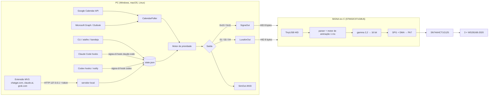
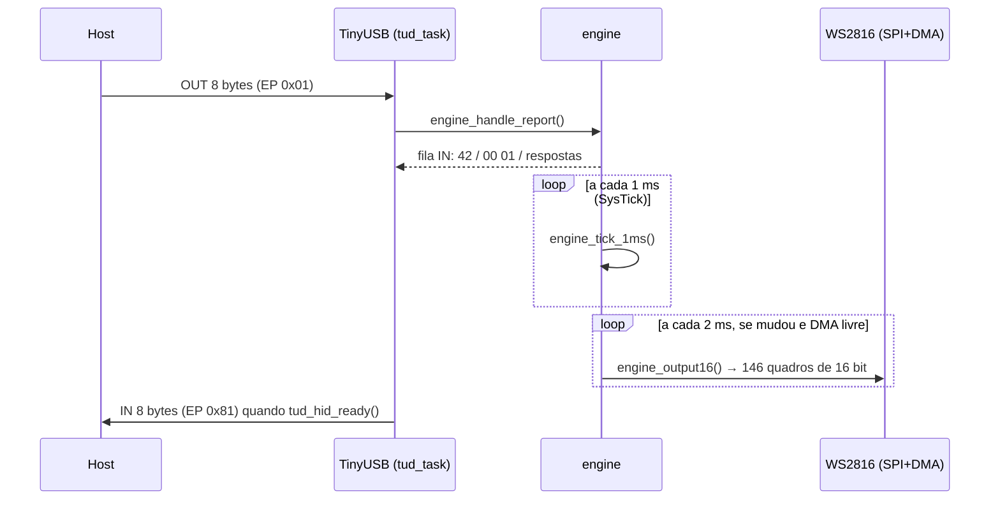
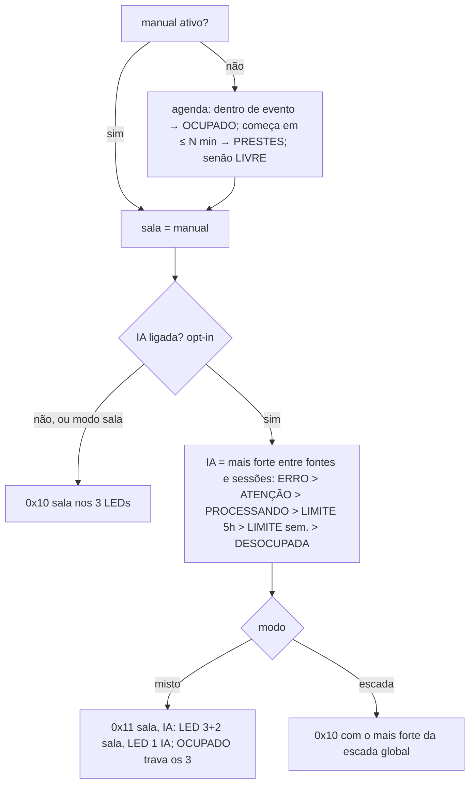

# SIGNA rev C — arquitetura do software

22 nov. 2026 · firmware 0.1 · app 0.1. Fonte dos estados: `data/produto.json` (cópia do caderno). Especificação de comportamento: `luxpcb-revC/docs/firmware_comportamento.md`.

## 1. Visão geral

Um comando por transição: as curvas (respiração, pulso, estrobo, pulso duplo) rodam no firmware, então o USB fica quieto entre mudanças de estado. Com o Luxafor original (sem estados), o app desenha as curvas mandando `01` a ~25 Hz, ou usa os opcodes do Flag (`04` wave 5, `03` strobe).

## 2. Firmware

### 2.1 Módulos

| Arquivo | Papel | Testado no PC |
|---|---|---|
| `src/engine.c/.h` | parser HID + motor de animação (C puro, sem hardware) | sim, `tests/test_engine.c` com ASan/UBSan |
| `src/signa_tables.c/.h` | gerado por `tools/gen_tables.py` de `produto.json`: gamma, tabelas de respiração, estados | vetores Python × C |
| `src/ws2816.c` / `ws2816_encode.c` | driver SPI1 + DMA1 / codificação dos bits | codificação e margens, `tests/test_ws.c` |
| `src/nvm_log.c` / `nvm.c` | serial em flash com nivelamento de desgaste | sim, `tests/test_nvm.c` (inclui corte de energia) |
| `src/board.c` | relógios, SysTick, flash, option bytes | não (precisa da placa) |
| `src/usb_descriptors.c`, `usb_ids.h`, `tusb_config.h` | identidade e descritores USB | não |
| `src/main.c` | laço principal | não |

### 2.2 Laço principal

Sem RTOS e sem interrupção de DMA: o laço consulta `TCIF1` e `BSY`. A gravação de flash do serial acontece no laço (`nvm_task`), nunca dentro do callback USB.

### 2.3 Relógios e USB

- SYSCLK = HSISYS = HSI48 / 1 = 48 MHz (o reset deixa /4), 1 wait state.
- USB = HSIUSB48 aparado pelo CRS a partir do SOF de 1 kHz (sem cristal). `USBSEL = 0`.
- USB em PA11/PA12 (pinos 18/19). No UFQFPN28 eles já são os pinos padrão: **não** ligar o remapeamento PA9/PA10.
- Envelope igual ao Flag: 1 interface HID vendor `0xFF00`, 8 bytes IN e 8 bytes OUT, sem Report ID, EP `0x81`/`0x01` interrupt 1 ms, 100 mA.

### 2.4 Dados dos LEDs (PA7 → buffer → WS2816B)

Netlist rev C: pino 13 do MCU = **PA7** = `LED_DIN_3V3` → U3 SN74AHCT1G125 (3,3 V → 5 V) → R3 33 Ω → D1.DI. O PA7 tem SPI1_MOSI (AF0), TIM3_CH2 (AF1), TIM1_CH1N, TIM14_CH1 e TIM17_CH1. Escolhido **SPI1_MOSI + DMA** (DMAMUX req 17), em modo só transmissão, quadros de 16 bit a 12 MHz:

| Bit | Quadro | Alto | Baixo | Datasheet WS2816B |
|---|---|---|---|---|
| 0 | `0xE000` | 250 ns | 1083 ns | T0H 200–320 ns, T0L 800–1200 ns |
| 1 | `0xFF00` | 667 ns | 667 ns | T1H 520–800 ns, T1L 480–1000 ns |
| ciclo | 16 bits | 1,333 µs | | ≥ 1,25 µs |

Tolerância: com o HSI a ±1 %, T0H fica em 248–253 ns e T1H em 660–673 ns, longe dos limites (o pior caso é T0H, com folga de 48 ns até 200 ns e de 67 ns até 320 ns, ou seja, aguenta cerca de ±20 % de erro de relógio). O AHCT1G125 soma alguns ns de atraso de propagação e quase nada de distorção de largura. Quadro: 1 + 144 + 1 palavras = 195 µs; reenviado no máximo a cada 2 ms, então a linha fica > 1,8 ms em baixo (reset > 280 µs). Ordem **G16 R16 B16, MSB primeiro** (datasheet: "Data transmit in order of GRB, high bit data at first"). O primeiro LED da cadeia é D1 = LED 1 (baixo).

**A validar na placa:** que o SPI do C0 mantém os quadros colados com DMA (sem intervalo entre palavras), com analisador lógico ou osciloscópio no R3; e a ordem G/R/B real (teste: `01 FF FF 00 00` tem que dar vermelho).

### 2.5 Brilho: 8 bit no fio, 16 bit no LED

O protocolo continua com R, G, B de 8 bit. O motor guarda as cores em 16 bit lineares (255 → 65535), aplica o nível do estado (Q12) e o brilho global (`0x12`), e passa por uma gamma 2,2 (LUT de 257 pontos com interpolação) antes de mandar 16 bit por canal. O fade do `0x02` interpola em 16 bit, então não tem degraus visíveis. Compatibilidade de aparência: o Flag original é PWM linear de 8 bit, então cores intermediárias ficam mais escuras no SIGNA. Isso segue a §6 da especificação.

### 2.6 Serial e NVM

- Última página da flash (0x0800F800, 2 KB), fora do `.text` no linker.
- Registro de 16 bytes: `'S' 'G' | seq | serial[6] | crc16 | 00000000`. São 128 gravações por apagamento. Uma gravação cortada no meio fica inválida e vale a anterior.
- Sem registro: serial = 6 bytes do UID de 96 bit dobrados (único por chip). `iSerial` = 12 dígitos hex.
- `0x51` grava 6 bytes, `0x52` grava os 4 primeiros (eco dos argumentos, como no original). Gravação igual à atual não toca a flash. `0x62` lê o atual. `0x80` e o descritor mostram a cópia do boot.

### 2.7 Gravação: DFU, SWD e option bytes

- Chip novo (flash vazia): o bootloader da ROM entra sozinho em DFU (`0483:df11`).
- Depois da 1ª gravação, para o **JP1** (PA14/BOOT0 a 3V3 por R4) voltar a servir para entrar em DFU, é preciso **`nBOOT_SEL = 0`** nos option bytes. Com isso o pino BOOT0 passa a decidir: com o JP1 aberto o PA14 fica em 0 e o chip roda o firmware; com o JP1 fechado ele entra no bootloader.
- Padrão: um passo único com o STM32CubeProgrammer (ver README). Opcional: `make AUTO_NBOOT_SEL=1` faz o firmware zerar o bit no 1º boot (só esse bit; o resto do OPTR é regravado igual).
- PA14 também é SWCLK. Com JP1 fechado e SWD conectado, o R4 de 1 kΩ fica em paralelo com o SWCLK: manter o JP1 aberto ao depurar.

## 3. Protocolo HID

### 3.1 Compatível com o Luxafor Flag (fw `0x3c`)

| Op | Bytes | Resposta | Fim `00 01` | Temporização |
|---|---|---|---|---|
| `00` | `00 …` | `42` | — | — |
| `01` | `01 alvo R G B` | `42` | — | imediato |
| `02` | `02 alvo R G B tempo` | `42` | sim (imediato se cor = atual ou tempo = 0) | max(\|Δ\|) × tempo × 0,252 ms |
| `03` | `03 alvo R G B tempo 00 rep` | `42` | sim, exceto rep = 0 | rep × tempo × 65,5 ms, 50 % aceso, restaura a cor anterior |
| `04` | `04 tipo R G B 00 rep vel` | `42` | só tipo 5 | ciclo = vel × 65 ms; tipo fora de 1–5 = silêncio |
| `06` | `06 id rep` | `42` | sim, exceto id 2 | 1: 2,1 s · 2: 3,6 s (sem fim) · 3: 11,5 s · 4: 15,8 s · 5: 0,9 s · 6: 2,6 s · 7: 1,35 s · 8: 3,5 s; id 0 e 9+ = silêncio |
| `51` / `52` | `51 b1..b6` / `52 b1..b4` | eco | — | grava na flash fora do callback |
| `62` | `62` | `62 b1 b2 b3 b4` | — | serial atual |
| `80` | `80` | `80 3c s1 s2 s3 s4` | — | versão compatível + serial do boot |
| `05`, `07`–`0F`, demais | | silêncio | | |

Alvo: `01`, `02`, `03`, `FF` agem. `04`–`06`, `41` e `42` dão ACK e não fazem nada (herança do Flag de 6 LEDs). Qualquer outro, inclusive o `0x13` que trava o Flag original, recebe silêncio e não tem efeito; o valor cru nunca indexa um vetor (o teste varre os 256 valores e faz fuzz de 200 mil relatórios aleatórios).

`rep = 0` repete até o próximo comando de LED. Um comando de LED novo interrompe a animação (strobe, wave e padrão interrompidos voltam para a cor anterior). As consultas `00`, `62`, `80` e `1F` não interrompem.

Os padrões e as waves são aproximações visuais do original, feitas a partir das descrições do `PROTOCOLO.md`. A temporização bate com o original; a forma exata, não necessariamente.

### 3.2 Opcodes nativos SIGNA (faixa `0x10`–`0x1F`, silêncio no Flag)

| Op | Bytes | Efeito | Resposta |
|---|---|---|---|
| `10` | `10 estado` | os 3 LEDs mostram o estado | `42` |
| `11` | `11 estado_sala estado_ia` | LED 3+2 = sala, LED 1 = IA; sala = OCUPADO trava os 3 em `#FF3B2F` | `42` |
| `12` | `12 brilho` | escala global 0–255 | `42` |
| `1F` | `1F` | identificação | `1F 'S' 'G' maj min proto nleds 00` |

Estados (`signa_tables.h`, `signa/states.py`): `0` apagado · `1` LIVRE · `2` PRESTES · `3` OCUPADO · `4` IA DESOCUPADA · `5` PROCESSANDO · `6` ATENÇÃO · `7` ERRO · `8` LIMITE 5 h · `9` LIMITE semanal. Estado inválido ou fora da zona certa = silêncio. Reenviar o mesmo estado não reinicia a fase da curva.

| Estado | Cor | Curva (firmware = `caderno.py::brilho_estado`) |
|---|---|---|
| LIVRE | `#2FD28A` | fixo 0,28 |
| PRESTES | `#FF8A1A` | respiração 3,0 s, piso 0,20, expoente 1,4 |
| OCUPADO | `#FF3B2F` | fixo 1,0 |
| IA DESOCUPADA | `#7C8EA6` | fixo 0,08 |
| PROCESSANDO | `#3D8BFF` | respiração 2,4 s, piso 0,15, expoente 1,6 |
| ATENÇÃO | `#FFE02E` | quadrada 1 Hz, 50 %, piso 0,06 |
| ERRO | `#FF3FC8` | estrobo **2,5 Hz**, pulso 130 ms, piso 0,04 (abaixo de 3 Hz, WCAG 2.3.1) |
| LIMITE 5 h | `#9B5CFF` | pulso duplo a cada 3 s (250 ms, 250 ms de pausa, 250 ms) a 0,55, piso 0,06 |
| LIMITE semanal | `#9B5CFF` | fixo 0,28 |

## 4. Motor de prioridade (app)

Escada global: **OCUPADO > PRESTES > ERRO > ATENÇÃO > PROCESSANDO > LIMITE > LIVRE > IA DESOCUPADA**. O teste `tests/test_engine.py` confere todas as combinações sala × IA nos modos escada e misto.

Validade dos relatos de IA (configurável): PROCESSANDO sem sinal por 15 min vira DESOCUPADA (CLI que morreu), ERRO dura 10 min, LIMITE 5 h dura 5 h e LIMITE semanal 24 h, até chegar outro evento. Fontes fora da lista `[ai].sources` são ignoradas.

## 5. Fontes de estado

| Fonte | Como | Oficial? |
|---|---|---|
| Google Calendar | `events.list` (singleEvents, orderBy=startTime), escopo `calendar.events.readonly`, OAuth de app instalado com loopback | sim |
| Outlook / M365 | Graph `GET /me/calendarView`, escopo `Calendars.Read`, MSAL com fluxo de dispositivo, `Prefer: outlook.timezone="UTC"` | sim |
| Regras da agenda | ignora cancelado, recusado, "livre" (Google `transparency=transparent`, Graph `showAs=free`), local de trabalho e dia inteiro; "talvez" conta como ocupado (configurável) | — |
| Manual | `signa-cli sala ocupado --por 30m`, `signa-cli toggle`, bandeja, atalho global (pynput) | — |
| Claude Code | hooks: UserPromptSubmit/PreToolUse/PostToolUse → processando; PermissionRequest e Notification `permission_prompt` → atenção; Stop e `idle_prompt` → desocupada; StopFailure `rate_limit` → limite; outras falhas → erro; SessionEnd remove | sim (docs de 22/11/2026) |
| Codex CLI | hooks em `~/.codex/hooks.json` (mesmos nomes + PostModelRequest `status=failed` → erro/limite); ou `notify` (só `agent-turn-complete` → desocupada) | sim |
| ChatGPT, Claude e Grok na web | extensão MV3: botão "parar" visível = processando; texto de limite = limite; alerta = erro; terminou com a aba em segundo plano = atenção até você voltar | **não: heurística frágil** |
| 5 h × semanal | Claude Code e Codex: pelo texto do erro; web: pelo texto da página | **heurística, a validar** |
| Microfone/câmera em uso | não implementado (a definir por SO) | — |

## 6. Segurança e segredos

- Tokens OAuth (Google e o cache MSAL) ficam no chaveiro do sistema via `keyring`: Credential Manager no Windows, Keychain no macOS, Secret Service no Linux. O `config.toml` não tem segredo nenhum.
- O JSON do cliente OAuth do Google fica fora do repositório (`.gitignore` bloqueia `*client_secret*.json`).
- Servidor local só em `127.0.0.1`. Exige `X-Signa-Token` (arquivo `token.txt` com permissão 0600) e `Host` local, o que barra DNS rebinding. Só aceita fontes web e estados de IA.
- Os hooks sempre saem com código 0 e não escrevem no stdout, exceto o `{}` que o Stop do Codex exige, para nunca bloquear a CLI de IA.
- O app nunca envia endereço de LED fora de `{1, 2, 3, FF}`.

## 7. Testes

- Firmware no PC (`make test`): 262 verificações do motor (temporização de fade, strobe, wave e padrão, endereços, serial, fuzz, curvas, misto e gamma), 2.005 do NVM e 16 da codificação WS2816B. Tudo com ASan e UBSan.
- App (`pytest`): 32 testes. Incluem a integração em que o app conversa com o mesmo `engine.c` compilado como biblioteca, tanto no caminho nativo quanto no fallback Luxafor.
- Não testado: nada em silício. USB real, CRS, SPI/DMA, gravação de flash e option bytes dependem da placa.
